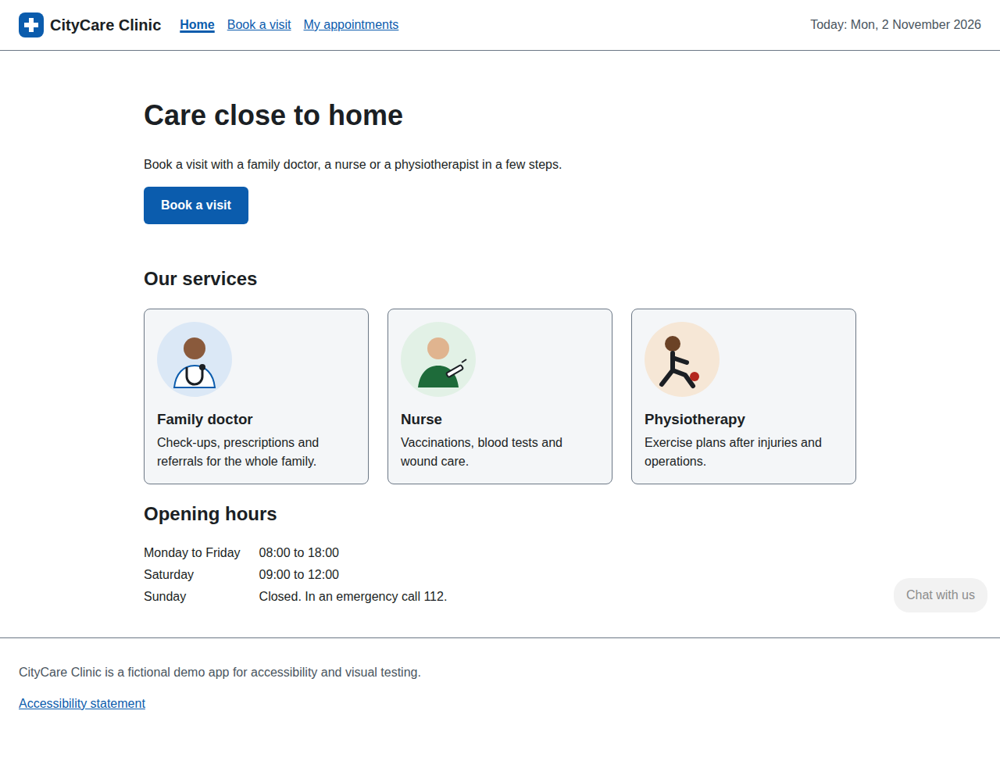
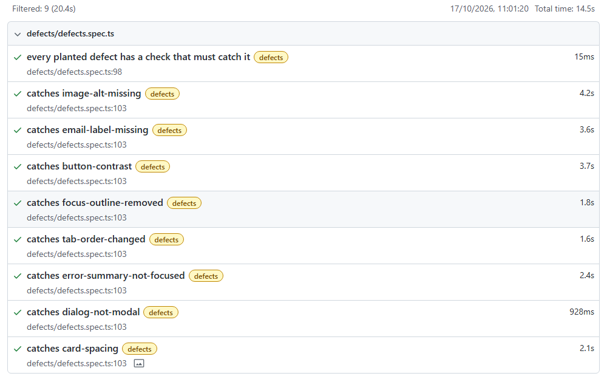
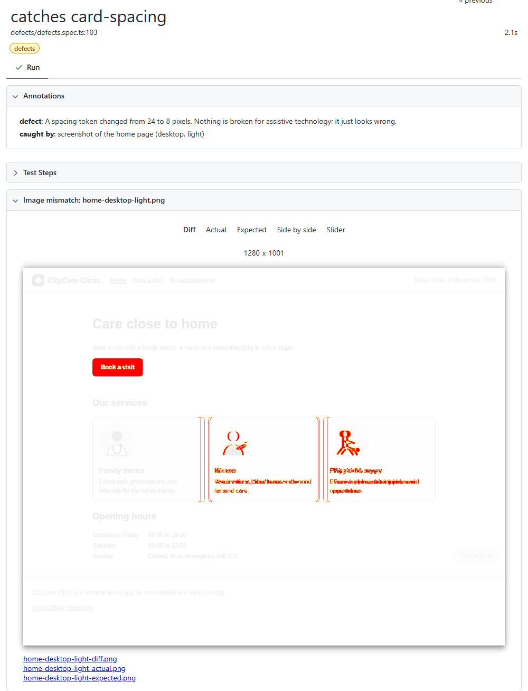

# Accessibility and visual regression testing

[](https://github.com/niranjankagri/accessibility-visual-testing/actions/workflows/ci.yml)

Two kinds of bugs that functional tests let through, checked automatically with **Playwright + TypeScript**:

- **Accessibility:** can people who use a keyboard, a screen reader, zoom or high contrast use the app? Checked
  against **WCAG 2.2 AA** with **axe-core**, plus keyboard and layout tests for what axe cannot see.
- **Visual regressions:** does every page still look as approved? Pixel comparison against reviewed baselines, at
  two screen sizes, in light and dark mode.

The app under test is in the repository: **CityCare Clinic**, a small fictional booking site (Node, no
dependencies). It also comes in a **regressed** build with eight realistic defects planted on purpose, and the
suite has to catch every one of them. A test suite that is green on a good build proves little until it also goes
red on a broken one.



**Why the app is in this repository:** the tests run against their own copy, started fresh for every run, locally and in
CI. No shared or hosted environment means no outages, no test data shared between runs, and no change somewhere else
that breaks these tests; one clone and one command run everything. It is also built for this suite: a regressed build
with planted defects, and pages that render the same pixels on every run.

## What is checked

| Area                 | Tests                                                                                                                  | How                                                                              |
| -------------------- | ---------------------------------------------------------------------------------------------------------------------- | -------------------------------------------------------------------------------- |
| WCAG rules           | every page in light and dark mode, the form with errors, the confirmation, the open dialog                             | axe-core with WCAG 2.0/2.1/2.2 A + AA and best-practice rules                    |
| Keyboard             | tab order, a visible focus indicator on every stop, skip link, form completed without a mouse                          | Tab through the page and record each focused element                             |
| Focus management     | error summary focused after a failed submit, errors linked to fields, dialog traps focus, Escape closes, focus returns | the same checks a screen reader user depends on                                  |
| Layout               | reflow at 320 CSS px (400% zoom), increased text spacing, reduced motion                                               | WCAG 1.4.10, 1.4.12, 2.3.3                                                       |
| Visual               | 4 pages × desktop/mobile × light/dark, plus errors, confirmation, dialog, focus ring, hover: 21 baselines              | `toHaveScreenshot`, zero pixel tolerance, rendered in the Playwright Linux image |
| The tests themselves | 8 planted defects, each must be reported by the check named for it                                                     | `defects` project against the regressed build                                    |

**86 Playwright tests** (accessibility in Chromium and Firefox, visual, defects) and **28 unit tests** (`node:test`)
for the exception rules and the app's defect catalogue.

## Proof: every planted defect is caught

| Planted defect (`app/defects.ts`)                                | Who it hurts                          | Caught by                                   |
| ---------------------------------------------------------------- | ------------------------------------- | ------------------------------------------- |
| `image-alt-missing`: illustration without a text alternative     | screen reader users                   | axe `image-alt`                             |
| `email-label-missing`: label turned into a styled paragraph      | screen reader and voice control users | axe `label`                                 |
| `button-contrast`: lighter brand blue, 2.5:1 instead of 4.5:1    | low vision                            | axe `color-contrast` (and the screenshots)  |
| `focus-outline-removed`: the "ugly" focus ring removed           | keyboard users                        | focus indicator check                       |
| `tab-order-changed`: `tabindex="1"` to promote a link            | keyboard users                        | tab order check (and axe `tabindex`)        |
| `error-summary-not-focused`: focus no longer moved to the errors | screen reader users                   | error handling check                        |
| `dialog-not-modal`: `show()` instead of `showModal()`            | keyboard and screen reader users      | dialog check: focus escapes, Escape ignored |
| `card-spacing`: a spacing token from 24 px to 8 px               | everyone, a little                    | screenshot comparison                       |



The visual defect, as the report shows it (expected, actual and diff images are attached to the test):



## What it found in the "good" app while I built it

The checks found four real problems in code I had just written and believed was fine:

- **Date field focus:** in Chromium, Tab reaches the calendar button inside a date field, which shows a nearly
  invisible focus ring. The focus indicator check flagged it; the fix styles `input:focus-within`.
- **Hidden text widening the page:** at 320 px the appointments page scrolled sideways by 146 px. The
  visually-hidden "appointment on 12 November" text is absolutely positioned and escaped the table's scroll
  container. The reflow test caught it; the fix is `position: relative` on the container.
- **Contrast measured mid-animation:** axe reported contrast as "could not decide" while the 400 ms fade-in was
  still running. Scans now wait for running animations to finish.
- **A third-party widget:** the vendor's chat badge has 3:1 contrast. That one is a known issue, handled below.

## Known issues: exceptions with a ticket and an expiry date

A real product often has an issue it cannot fix today (here: the vendor's chat badge). Turning the rule off would
hide it everywhere; failing every build would teach the team to ignore the suite. Instead
[`a11y-exceptions.json`](a11y-exceptions.json) lists it with a ticket, a reason and an expiry date:

```json
{
  "rule": "color-contrast",
  "target": ".vendor-chat > button",
  "ticket": "A11Y-12",
  "reason": "Third-party chat badge; we cannot change its colours. ...",
  "expires": "2027-03-31"
}
```

- The exception covers **that rule on those elements only**: the same rule anywhere else still fails.
- After the expiry date the finding fails the build again, with "exception A11Y-12 expired on 2027-03-31".
- An exception that no longer excuses anything fails a test, so it is removed when the issue is fixed.
- The [accessibility statement](app/web/accessibility.html) of the app names the issue and the workaround.

## Why the screenshots are taken in Docker

Fonts and anti-aliasing differ between Windows, macOS and Linux, so a screenshot from a laptop never matches one from
CI pixel for pixel. The baselines are rendered in the official Playwright Linux image only, locally through
`npm run visual:docker` and in CI by running the job inside the same image. With the same browser build and the same
fonts, any different pixel is a real change, so the tolerance is zero. Text uses Arial with Liberation Sans (same
metrics) as the Linux fallback; the clock is fixed and the random booking reference is masked.

On Windows, `npm test` runs everything except the screenshot comparisons, which are skipped with a message pointing
to Docker.

## Running it (Windows cmd)

Needs Node 24.2 or later. Docker Desktop for the visual tests.

```
cd /d D:\Data\Work\portfolio-projects\accessibility-visual-testing
npm ci
npx playwright install chromium firefox

npm test                    all projects; visual comparisons skipped outside Linux
npm run test:a11y           axe, keyboard and layout tests in Chromium and Firefox
npm run test:defects        the regressed build: every planted defect must be caught
npm run test:unit           exception rules and defect catalogue (no browser)
npm run docker              every project inside the Playwright Linux image
npm run visual:docker       only the screenshot comparisons, in Docker
npm run visual:update       re-render the baselines in Docker (review the image diff before committing)
npm run a11y:summary        table of the last run's scans, blocking and excused findings
npm run report              open the HTML report
npm run app                 the app on http://127.0.0.1:4310 (app:regressed on 4311)
```

## Project structure

```
app/
  server.ts               the app: pages in a layout, assets, a 404 page; --variant regressed
  defects.ts              the eight planted defects (text replacements in app/web)
  server.test.ts          unit tests: pages, assets, every defect still applies
  web/                    HTML pages, styles.css (colour tokens, dark mode), app.js, SVG illustrations
tests/
  a11y/                   axe.spec.ts, keyboard.spec.ts, layout.spec.ts
  visual/                 pages.spec.ts, states.spec.ts and __screenshots__/ (the approved baselines)
  defects/defects.spec.ts each planted defect, the check that must catch it and the finding it must report
  pages/                  page objects: BasePage, HomePage, BookingPage, AppointmentsPage, AccessibilityPage,
                          the CancelDialog component, and ALL_PAGES for the checks that run on every page
  data/visits.ts          booking details (Visit) with named sample visits
  support/                axe scan + exceptions, keyboard checks, screenshot helper
  unit/                   exception rules (node:test)
scripts/
  docker.ts               runs Playwright in the Linux image with the repo mounted
  a11y-summary.ts         Markdown summary of the scans (also the CI job summary)
a11y-exceptions.json      known issues: ticket, reason, expiry
```

## Design

| Pattern             | Where                                                                               | Why                                                                                                                |
| ------------------- | ----------------------------------------------------------------------------------- | ------------------------------------------------------------------------------------------------------------------ |
| Page Object Model   | `tests/pages`: one class per page, extending `BasePage`                             | locators live in one place; specs only call page methods and assert                                                |
| Component object    | `CancelDialog`                                                                      | the modal dialog is modelled once, used by the axe, keyboard, visual and defects specs                             |
| Accessible locators | `getByRole` and `getByLabel` inside the page objects                                | a missing name or label breaks the locator, so every UI test is also a small accessibility check                   |
| Registry            | `ALL_PAGES` (name + factory)                                                        | the checks that run on every page loop over one list; adding a page adds it to all of them                         |
| Test data object    | `Visit`, `NURSE_BY_VIDEO`, `PHYSIO_IN_PERSON`                                       | what is booked, instead of six fields filled in each spec                                                          |
| Check functions     | `tests/support`: axe `scan`, `tabThrough`, `dialogFindings`, `errorSummaryFindings` | return findings instead of asserting, so the same check proves the good build passes and the regressed build fails |

## CI

[`.github/workflows/ci.yml`](.github/workflows/ci.yml): typecheck, lint, format and unit tests first; then the
accessibility suite in Chromium and Firefox, and the screenshot comparisons plus the defects project inside the
Playwright image. Each job writes the scan summary into the job summary and uploads the HTML report, which holds the
expected, actual and diff images when a screenshot changed.

## What automation does not replace

axe finds a part of the WCAG problems a page can have, and the keyboard tests cover the main paths. A clean run is
evidence, not a conformance claim. Screen reader testing (NVDA, VoiceOver), checking that alternative texts and
messages make sense, and testing with people who use assistive technology stay manual. See
[docs/framework-design.md](docs/framework-design.md) for the design decisions and
[docs/interview-questions.md](docs/interview-questions.md) for questions and answers on the topic.

## License

MIT
